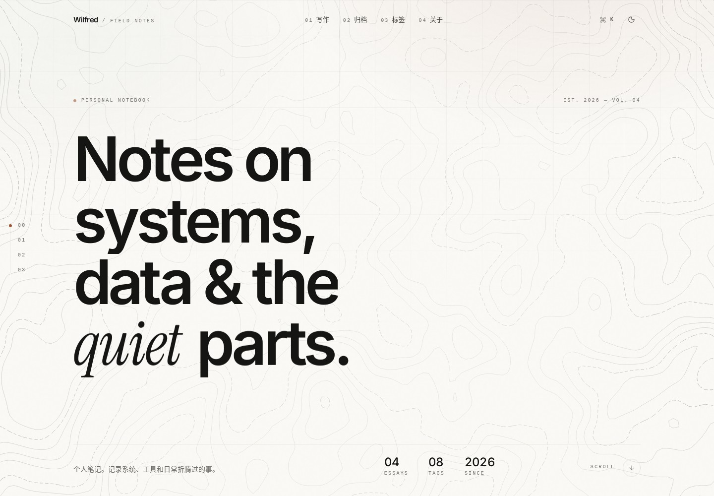

# wilfoo-blog

[](./LICENSE)

[wilfoo.com](https://wilfoo.com) 的源码。基于 Next.js 16（App Router）静态导出的极简个人博客，主打文字排版、程序生成的等高线地形图背景、Lenis 平滑滚动与 Framer Motion 滚动叙事。

构建产物为纯静态 HTML / CSS / JS，无数据库、无服务端运行时。

## 预览

| 首页（亮色） | 首页（暗色） |
| :---: | :---: |
|  |  |

| 文章页 | 移动端 |
| :---: | :---: |
|  |  |

## 特性

- **纯静态导出**：`output: "export"` + `trailingSlash: true`，可直接部署到 Cloudflare Pages 或任意静态托管平台。
- **等高线地形图背景**：基于 Simplex 噪声与 Marching Squares 算法实时生成 SVG 等高线，支持滚动与鼠标视差；文章卡片采用以 slug 为种子的稳定地形图。
- **双主题与动效**：暖纸白（`#faf9f6`）与深色（`#0a0a0b`）双模式，支持 `View Transition` 圆形扩散切换；内置 Lenis 平滑滚动、主页锚点导航、Spotlight 卡片与动效开关。
- **阅读体验**：Markdown 在构建期经 unified / remark / rehype 渲染，Shiki 代码高亮与一键复制，文章页带顶部阅读进度线与粘性高亮目录。
- **检索与订阅**：内置客户端全文搜索（`⌘K` 命令面板与 `/search/` 页面），自动生成 `/feed.xml`（RSS）、`/sitemap.xml` 与 `/index.json`。
- **轻量字体策略**：自托管 Inter Variable 与 Instrument Serif（仅拉丁字符集，约 91 KB），中文直接回退到系统无衬线字体，不额外加载中文字体包。
- **渐进增强**：遵循 `prefers-reduced-motion` 并提供手动动效开关；关闭 JS 时仍可完整阅读正文。

## 技术栈

- **框架**：Next.js 16（App Router）、React 19、TypeScript
- **样式**：Tailwind CSS v4（CSS-first）
- **动效**：Framer Motion 14、Lenis 1.3
- **内容渲染**：gray-matter、unified / remark / rehype、Shiki
- **图标**：Lucide React
- **工具**：Playwright Core（仅开发期用于生成 OG 图）

## 目录结构

```text
.
├── content/
│   ├── about.md                 # 关于页正文
│   └── posts/*.md               # Markdown 文章
├── docs/preview/                # README 预览截图
├── public/
│   ├── og.jpg                   # Open Graph 社交分享图
│   ├── _headers                 # Cloudflare Pages 响应头
│   ├── _redirects               # 路由重定向规则
│   └── favicon.* / manifest     # 站点图标与 PWA 清单
├── scripts/
│   └── make-og.mjs              # 本地重新生成 public/og.jpg
├── src/
│   ├── app/                     # App Router 页面与静态路由（RSS / 搜索索引 / Sitemap / Robots）
│   ├── components/              # Hero、Bento、等高线背景、动效封装、导航、搜索、目录等组件
│   ├── fonts/                   # 自托管拉丁字体（woff2）
│   └── lib/                     # 文章解析、Markdown 渲染、等高线生成、搜索、站点配置
├── next.config.ts
└── wrangler.toml
```

## 本地开发

需要 Node.js >= 20.9（仓库包含 `.nvmrc`，默认指定 22）。

```bash
npm install
npm run dev          # 启动开发服务器 http://localhost:3000
npm run typecheck    # TypeScript 类型检查
npm run build        # 静态导出到 out/
npm start            # 本地预览 out/（端口 4321）
```

### 重新生成 OG 图

先在本地启动静态预览，再运行脚本覆盖 `public/og.jpg`（默认调用系统 Chrome，也可通过 `CHROME_PATH` 或 `OG_BASE_URL` 覆盖）：

```bash
npm run build
npm start            # 监听 http://127.0.0.1:4321
npm run og
```

## 写作

在 `content/posts/` 下新建 Markdown 文件（例如 `content/posts/hello.md`）：

```yaml
---
title: "文章标题"
date: 2026-11-26T10:00:00+08:00
draft: false
tags: ["Linux", "Notes"]
summary: "出现在列表、SEO 与 RSS 里的一句话摘要。"
ShowToc: true      # 可选，设为 false 隐藏目录
TocOpen: false     # 可选，设为 true 时移动端目录默认展开
---

正文内容，支持 GFM 表格、任务列表与 Shiki 代码高亮。
```

- `date` 按 `Asia/Shanghai` 格式化，列表按时间倒序排列。
- `draft: true` 在 `npm run dev` 下可见，生产构建时自动跳过。
- 图片放在 `public/images/`，正文使用 `` 引用。
- 归档、标签页、搜索索引、RSS 与 Sitemap 均在构建期自动生成。

## 部署

### Cloudflare Pages（Git 集成）

1. 在 Cloudflare Pages 创建项目并连接仓库。
2. 构建配置：
   - **Framework preset**：`None`
   - **Build command**：`npm run build`
   - **Build output directory**：`out`
3. 环境变量按需配置 `NODE_VERSION=22`（或直接使用 `.nvmrc`）。

### 手动部署（Wrangler）

```bash
npm run build
npx wrangler pages deploy out --project-name wilfoo-blog
```

## 自定义说明

- **站点信息与导航**：[src/lib/site.ts](./src/lib/site.ts)
- **配色与排版 Token**：[src/app/globals.css](./src/app/globals.css)（修改 `--accent` 可直接更换点缀色）
- **背景等高线参数**：[src/components/contour-background.tsx](./src/components/contour-background.tsx)
- **全局动效曲线与平滑滚动**：[src/components/motion.tsx](./src/components/motion.tsx)、[src/components/smooth-scroll.tsx](./src/components/smooth-scroll.tsx)

## License

- 源码采用 [MIT License](./LICENSE)。
- 自托管字体（Inter、Instrument Serif）遵循 SIL OFL 1.1，详见 [FONT-LICENSES.md](./FONT-LICENSES.md)。
- `content/` 目录下的原创文章版权归作者所有。
