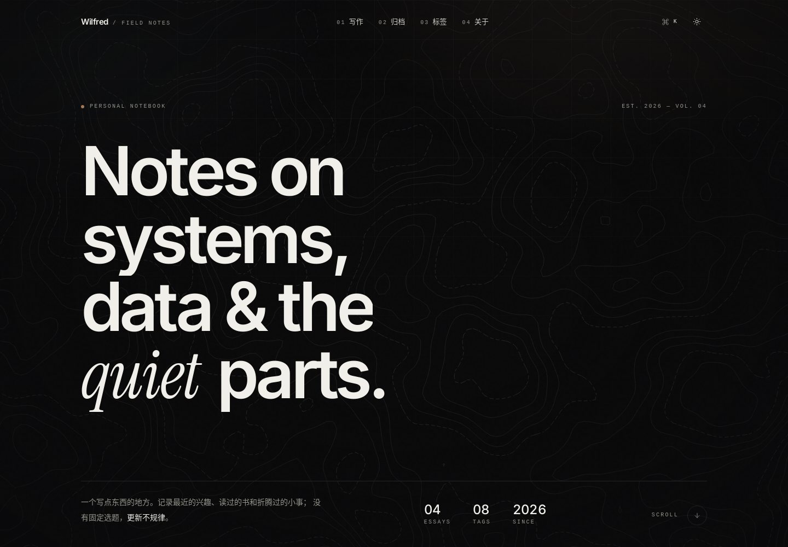
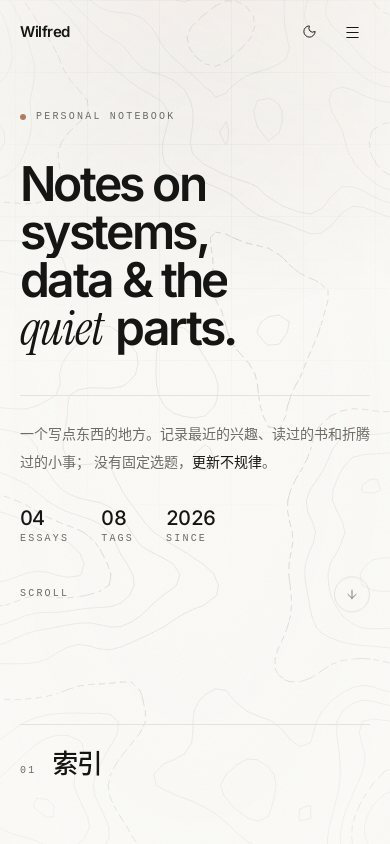

# wilfoo.com — field notes

[](./LICENSE)

[wilfoo.com](https://wilfoo.com) 的源码。现代极简（Modern Minimalist）、文字驱动、等高线地形图背景、Lenis 平滑滚动与 Framer Motion 滚动叙事。

Next.js 16（App Router）静态导出，构建产物是纯 HTML/CSS/JS，没有数据库，也没有运行时。







---

## 1. 视觉与动效

### 视觉

| 项目 | 做法 |
| --- | --- |
| 底色 | 暖纸白 `#faf9f6`；深色 `#0a0a0b`，带极细网格与渐变 |
| 字体 | Inter Variable（拉丁）+ 系统中文无衬线；Instrument Serif 只用于一两个词的斜体强调 |
| 字号 | 首屏 `clamp(3rem, 8.6vw, 8rem)`，正文 17px/1.95，元信息 10px 大写 |
| 布局 | 12 栅格 + Bento Grid；文章正文与 TOC 分栏，TOC sticky |
| 色彩 | 黑 / 白 / 灰为主，陶土色 `#9c5636`（暗色 `#d29a78`）只做点缀 |
| 背景 | 等高线地形图，每次访问随机生成；深色模式额外叠加 72px 网格 |

设计 token 全部在 [`src/app/globals.css`](./src/app/globals.css) 顶部的 `:root` / `.dark` 里；想换主色只改 `--accent`。

> 中文标题请用 `.display-cn`（行高 1.24）。`.display` 的 0.92 行高是为拉丁字母准备的，直接套中文会上下行重叠。

### 动效

- **Lenis**：`src/components/smooth-scroll.tsx`，`lerp 0.09` / `duration 1.15`。锚点点击统一走 `lenis.scrollTo`，并带 `-96px` 的顶栏偏移。`prefers-reduced-motion` 下完全不初始化。
- **滚动显现**：`Reveal`（单个淡入上移）、`Stagger` / `StaggerItem`（错开延迟）、`Rise`（首屏遮罩内升起）。
- **视差**：`Parallax` 组件 + 首屏 headline 的 `useScroll`/`useTransform`；背景地图自身也有滚动与鼠标视差（弹簧阻尼）。
- **Sticky**：归档页年份、文章页目录都使用 `position: sticky`；目录用滚动位置计算当前章节，并用 `layoutId` 做小圆点滑动。
- **微交互**：
  - Bento 卡片 `SpotlightCard` / `SpotlightLink`：指针位置写入 `--mx/--my`，CSS 径向渐变跟随；Framer Motion 弹簧做 3px 上浮 + 1.005 缩放。
  - 按钮 `SpringTap`：hover 1.04 / tap 0.93。
  - 链接 `Magnetic`：文字向指针偏移几像素。
  - 文章列表悬停时跟随鼠标的等高线小地图（仅桌面端）。
  - 主题切换：`document.startViewTransition` 圆形揭示，从按钮位置扩散；不支持或被中断时自动降级。
- **阅读进度**：文章页顶部 2px 陶土色进度线；TOC 左侧竖线同步填充。
- **无 JS / 减少动效**：`prefers-reduced-motion` 全部静态化；`<noscript>` 会把所有 Framer 初始隐藏状态还原，正文仍可阅读。

---

## 2. 技术栈

- Next.js 16 App Router，`output: "export"`，`trailingSlash: true`
- React 19、TypeScript
- Tailwind CSS v4（CSS-first 配置，无 `tailwind.config`）
- Framer Motion 14
- Lenis 1.3
- Lucide Icons
- unified / remark / rehype + Shiki（构建期渲染 Markdown）
- Playwright Core（仅用于生成本地 OG 图，devDependency）

字体全部自托管：`src/fonts/inter-latin.woff2`（48 KB）与 Instrument Serif 两个 woff2（约 43 KB），构建时由 `next/font/local` 指纹化，许可证见 [`FONT-LICENSES.md`](./FONT-LICENSES.md)。中文走系统字体（PingFang SC / 微软雅黑 / Noto Sans CJK），不下载任何中文字体包。

---

## 3. 目录

```
.
├── content/
│   ├── about.md                 # 关于页正文
│   └── posts/*.md               # 文章
├── public/
│   ├── og.jpg                   # 社交卡片
│   ├── _headers                 # Cloudflare Pages 响应头
│   ├── _redirects               # 旧 Hugo URL 兼容
│   └── favicon 等
├── scripts/make-og.mjs          # 重新生成 public/og.jpg
├── src/
│   ├── app/
│   │   ├── page.tsx             # 首页：Hero + Bento + Writing
│   │   ├── writing/page.tsx     # 全部文章
│   │   ├── archives/page.tsx
│   │   ├── tags/page.tsx
│   │   ├── tags/[tag]/page.tsx
│   │   ├── posts/[slug]/page.tsx
│   │   ├── about/page.tsx
│   │   ├── search/page.tsx
│   │   ├── feed.xml/route.ts    # RSS
│   │   ├── index.xml/route.ts   # 旧 RSS 地址
│   │   ├── index.json/route.ts  # 搜索索引
│   │   ├── sitemap.ts, robots.ts, not-found.tsx
│   │   └── globals.css          # 设计 token、prose、背景、动效降级
│   ├── components/
│   │   ├── hero.tsx, bento.tsx, writing-list.tsx
│   │   ├── contour-background.tsx, contour-art.tsx
│   │   ├── motion.tsx           # Reveal / Stagger / Rise / Parallax / Spotlight
│   │   ├── smooth-scroll.tsx, theme-provider.tsx, theme-toggle.tsx
│   │   ├── site-header.tsx, site-footer.tsx
│   │   ├── command-palette.tsx, search-client.tsx, search-card.tsx
│   │   ├── table-of-contents.tsx, reading-progress.tsx, code-copy.tsx
│   │   └── ...
│   └── lib/
│       ├── posts.ts             # frontmatter、排序、标签、TOC、阅读时长
│       ├── markdown.ts          # unified 渲染 + Shiki
│       ├── contour.ts           # simplex 噪声 + marching squares
│       ├── search.ts, site.ts, fonts.ts, theme.ts, utils.ts
│       └── ...
├── next.config.ts
└── wrangler.toml
```

---

## 4. 本地开发

```bash
npm install
npm run dev          # http://localhost:3000
npm run typecheck    # tsc --noEmit
npm run build        # 静态导出到 out/
npm start            # 用 serve 预览 out/，端口 4321
```

Node >= 20.9（`.nvmrc` 为 22，Cloudflare Pages 默认可用）。

---

## 5. 写作

新建 `content/posts/hello.md`：

```yaml
---
title: "标题"
date: 2026-11-06T15:30:00+08:00
draft: false
tags: ["Linux", "CSS"]
summary: "出现在列表、SEO 与 RSS 里的一句话摘要。"
ShowToc: true      # 可选，false 隐藏目录
TocOpen: false     # 可选，true 时移动端目录默认展开
---

正文，支持 GFM 表格、任务列表、脚注语法外的常规 Markdown。
```

- `date` 会按 `Asia/Shanghai` 格式化；排序按时间倒序。
- `draft: true` 在生产构建中不生成，但 `npm run dev` 可以看到。
- 代码块用三个反引号 + 语言名，Shiki 在构建期高亮（`github-dark-default`），并自动注入复制按钮。
- 图片放 `public/images/`，正文写 ``。构建期不做图片优化。
- 站内链接写绝对路径，例如 `/posts/why_hugo/`。

新增标签、归档、搜索索引、RSS、sitemap 都是构建时自动生成的，不需要改配置。

---

## 6. URL 与旧站兼容

| 旧 Hugo | 新站 |
| --- | --- |
| `/posts/<slug>/` | 同路径（`trailingSlash` 输出目录） |
| `/archives/` | 同路径 |
| `/tags/`、`/tags/<tag>/` | 同路径（中文标签 URL 编码） |
| `/about/` | 同路径 |
| `/search/` | 同路径（客户端全文检索） |
| `/index.xml` | 保留，内容同 RSS |
| `/index.json` | 保留，供客户端搜索与脚本使用 |
| `/feed.xml` | 新增，标准 RSS 地址 |
| `/posts` | `_redirects` 301 到 `/writing/` |

`public/_redirects` 只做了必要的 301，避免旧链接 404。

---

## 7. 部署到 Cloudflare Pages

### 7.1 Git 集成部署

1. Cloudflare Pages → Create project → 连接仓库 `WilfOo/wilfoo-blog`。
2. 构建配置：
   - Framework preset: **None**
   - Build command: `npm run build`
   - Build output directory: `out`
3. 环境变量：`NODE_VERSION=22`（或依赖 `.nvmrc`）。
4. 部署完成后检查预览域名，再绑定自定义域名。

### 7.2 手动部署（可选）

```bash
npm run build
npx wrangler pages deploy out --project-name wilfoo-blog
```

`wrangler.toml` 已配置 `pages_build_output_dir = "out"`。

---

## 8. 设计参数与二次开发

- **背景密度**：`src/components/contour-background.tsx` 的 `build()` 里 `cell`（越小越密）、`levels`（等高线层数）、`step`、`majorEvery`；颜色和透明度在 `globals.css` 的 `.contour-svg` 规则里。
- **卡片**：`src/components/bento.tsx`。Featured 卡的等高线是 `ContourArt`，`seed` 用 slug，因此每篇文章的地形图是稳定且唯一的。
- **动效节奏**：`src/components/motion.tsx` 的 `EASE = [0.16, 1, 0.3, 1]`，以及各 `duration`。改这里会统一影响全站。
- **平滑滚动**：`smooth-scroll.tsx` 的 `lerp` / `duration`。太“飘”就把 `lerp` 调大（0.12–0.15）。
- **主题**：`theme-provider.tsx` 的 `toggleTheme` 使用 View Transition；圆点在 `globals.css` 的 `@keyframes theme-reveal`。
- **OG 图**：先 `npm start`（4321），再 `npm run og`，会覆盖 `public/og.jpg`。脚本默认使用系统 Chrome，可通过 `CHROME_PATH` 覆盖路径。

---

## 9. 已知边界

- **纯静态**：没有评论、后台、服务端搜索；搜索索引是全量正文，放在 `/index.json` 里，任何人可下载。
- **中文字体**：依赖系统字体，不同平台字形会有差异；这是为了不背 1 MB 的中文 webfont。
- **图片**：`images.unoptimized`，没有 `next/image` 优化，适合少量插图；大量图片建议接 Cloudflare Images 或构建期压缩。
- **TOC 与阅读进度**基于滚动位置计算，长文性能良好；极长页面（>50 个标题）可能需要虚拟化。

---

## 10. License

- 代码部分采用 [MIT License](./LICENSE)。
- 自托管字体（Inter、Instrument Serif）遵循各自 SIL OFL 1.1 许可，详见 [`FONT-LICENSES.md`](./FONT-LICENSES.md)。
- `content/` 目录下的原创文章版权归作者所有。
